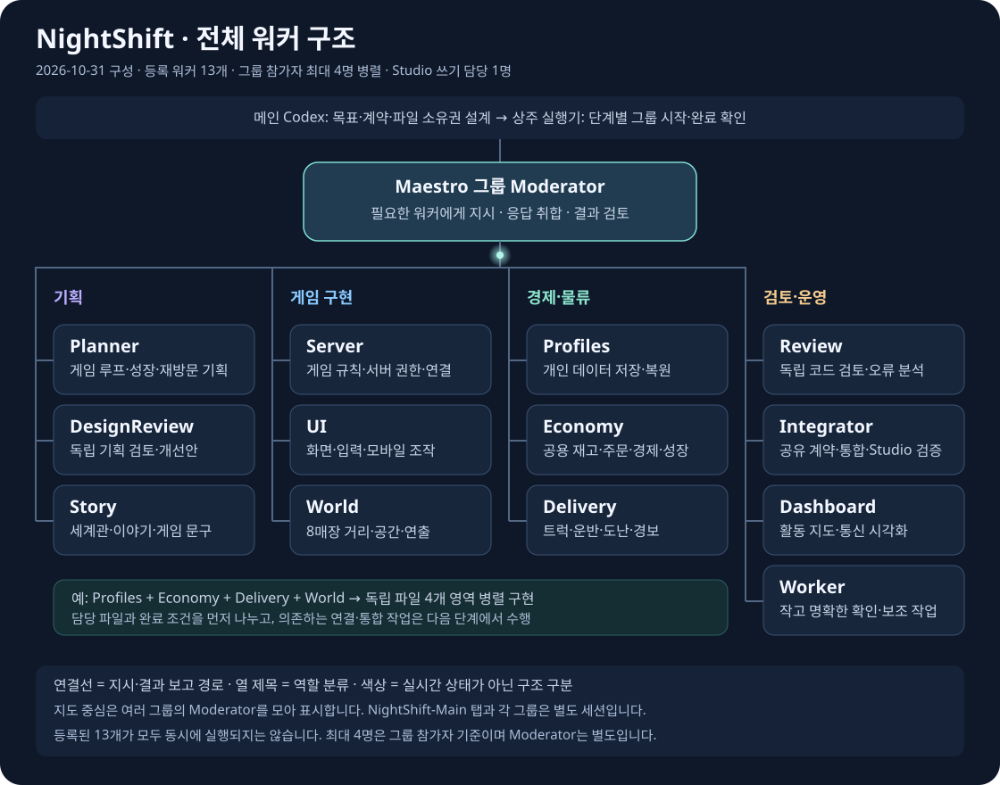
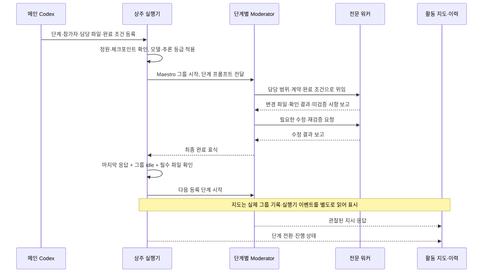
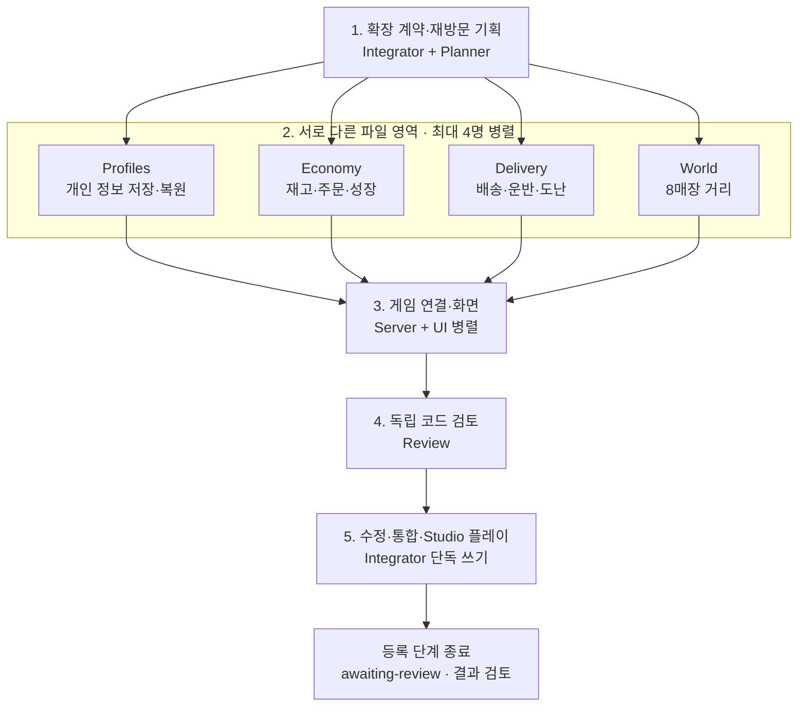

# 오늘도 정상영업

친구와 함께 운영하는, 조금 이상한 야간 편의점 Roblox 게임입니다. 게임 소스와 맵 생성기, 검사, Maestro 기반 개발 도구를 공개합니다. Roblox 게임 게시와 실제 상품 판매는 아직 하지 않았습니다.

## 오케스트레이터 전체 구조

**메인이 목표와 작업 범위를 정하고, Maestro의 단계별 Moderator가 전문 워커에게 작업을 나눕니다.** 상주 실행기는 완료 증거를 확인해 다음 등록 작업을 시작하고, 활동 지도는 실제 지시·응답과 진행 이력을 보여 줍니다.



이 그림은 **2026-10-31에 확인한 등록 구조**입니다. 색상은 역할 구분이며 실시간 실행 상태가 아닙니다. 모든 워커 이름에는 `NightShift-` 접두사가 붙습니다. 작은 화면에서는 [구조 그림 원본](docs/diagrams/orchestrator.svg)을 확대해서 볼 수 있습니다.

| 구성 요소 | 맡는 일 | 실제 구현·기록 |
| --- | --- | --- |
| 메인 Codex / `NightShift-Main` | 요구사항 정리, 작업 분해, 역할·파일 소유권 배정, 결과 판단 | [운영 규칙](AGENTS.md), 기획·계약 문서 |
| Maestro 그룹 Moderator | 해당 단계의 참가자에게 지시하고 응답을 취합·검토 | 단계별 그룹 대화와 완료 보고 |
| 전문 워커 13개 | 지정된 파일과 완료 조건 안에서 기획·구현·검토 | 위 역할 지도, [단계별 참가자](tools/development-pipeline.json) |
| 상주 실행기 | 단계 발행, 정원 확인, 완료 판정, 재시작 체크포인트 | [tools/runner/](tools/runner/README.md) — 로컬 Node.js 프로그램 |
| 활동 지도·이력 수집기 | 실제 통신·상태·모델 출처를 조회하고 시각화 | [tools/mission-control/](tools/mission-control/), [모바일 운영](docs/mobile-monitoring.md) |

현재 채팅의 메인 Codex, Maestro의 `NightShift-Main` 일반 탭, 각 그룹의 Moderator는 **서로 다른 세션**입니다. 활동 지도의 중심 노드는 그룹별 Moderator를 하나의 역할로 모아 보여 주며, 메시지 상세에는 실제 그룹·발신자·수신자·시각이 남습니다. Codex 내장 하위 에이전트도 Maestro 등록 워커와 별도입니다.

### 작업 하나가 진행되는 흐름



독립적인 파일 작업은 병렬로 수행합니다. 워커끼리 공유 계약·산출물을 사용하고, 수정 요청과 결과 취합은 단계별 Moderator가 조정합니다. Studio 편집과 플레이 시작·종료는 해당 통합 단계의 **Integrator 한 명**에게 맡깁니다.

### 현재 등록된 개발 순서

첫 버전의 **설계·독립 검토 → 공유 계약 → 맵·서버·UI 구현 → 코드 검토 → Studio 통합** 5단계 다음에 아래 확장 5단계가 연결되어 있습니다. 이 그림은 실행 순서이며 완료율 표시는 아닙니다.



실행 기준은 [development-pipeline.json](tools/development-pipeline.json)과 각 단계의 `setup-test/` 프롬프트입니다. **등록 워커 수 13개와 동시 참가자 정원 4명은 다른 값**입니다. 실행기가 새 단계를 발행하기 전에 다른 활성 그룹의 참가자까지 합산하며, 자리가 부족하면 `waiting-capacity`에서 기다립니다. Moderator와 이 채팅의 내장 하위 에이전트는 이 정원에 포함하지 않으며 수동 실행까지 모두 제한하는 전역 프로세스 제한도 아닙니다.

작업이 너무 크면 메인이 담당 파일·완료 조건을 나누고 기존 역할을 재사용하거나 전문 워커를 추가 등록합니다. 새 워커를 해당 단계의 참가자에 넣어야 실제 위임됩니다. 현재 실행기는 **명시적으로 등록된 단계**를 이어 실행하며, 모든 워커가 임의로 자식을 무제한 생성하는 구조는 아닙니다.

### 모델과 추론 수준 배정

| 작업 등급 | 설정 모델 | 추론 수준 | 현재 확장 단계의 예 |
| --- | --- | --- | --- |
| `complex` | `gpt-6-astra` | `high` | 저장·경제·서버 권한·독립 검토·통합 |
| `standard` | `gpt-6.1-sol` | `medium` | 확장 기획·맵·화면·배송 구현 |
| `simple` | `gpt-6-luna` | `low` | 작고 명확한 확인·정리 작업 |

메인이 작업 요구에 맞는 `modelAssignments`를 단계에 기록하고, 실행기가 **다음 단계 발행 전** [모델 배정 도구](tools/set-worker-model.cjs)로 지정된 참가자의 모델과 추론 수준을 적용합니다. 역할별 기본값·Moderator 정책은 [model-policy.json](tools/model-policy.json)에 있으며 단계의 명시적 등급이 역할 기본값보다 우선합니다. 이 자동 배정 경로는 Moderator 설정을 변경하지 않습니다. 실행 도중 모델이 스스로 난도를 판정해 교체되는 기능도 아닙니다. 지도는 **설정값**과 Codex `turn_context`에서 **실제로 관찰한 모델·추론 수준**을 구분합니다.

### 실제 진행 상황과 통신 기록

활동 지도에서는 메인 중심에서 전체 워커가 뻗어 나오며, 확인된 명령과 응답을 **연결선을 따라 이동하는 은은한 원형 광점**으로 보여 줍니다. 광점을 선택하면 원문과 방향을 확인할 수 있고, 과거 기록 재생은 실시간 관찰과 구분합니다. README의 구조 그림에는 실시간 상태가 자동 반영되지 않습니다.

| 기록 | 포함하는 정보 |
| --- | --- |
| 그룹 대화 보관 | 실제 지시·응답, 그룹·발신자·수신자·시각 |
| `.setup/history/activity.jsonl` | 관찰된 통신·상태 전환·소스/문서 해시 변경 |
| `.setup/runner/events.jsonl`, `state.json` | 단계 발행·완료·오류와 재시작 체크포인트 |
| `.setup/model-routing.jsonl` | 모델·추론 수준 배정 변경 |
| 지도 도구 활동 표시 | 관찰 가능한 도구 이름·호출 수·최근 시각; 내부 추론·인수·출력 전문 제외 |

로컬 지도는 `http://127.0.0.1:43821`이며 모바일 HTTPS 주소는 로컬 `.setup/mobile-link.txt`에서 확인합니다. 현재 외부 지도는 **공개·읽기 전용**입니다. PC·Maestro·지도 서버·터널이 켜져 있어야 실시간 조회가 됩니다. 실행 기록과 계정 정보는 Git에서 제외하며, 공개 저장소에는 소스·문서·검사 자료를 올립니다. 자세한 연결 범위는 [모바일 개발 상황실](docs/mobile-monitoring.md)을 참고하세요.

## 현재 구현과 검증

2026-10-31 기준, 기존 4점포 버전을 Roblox Studio에 통합하고 **실제 1클라이언트에서 주문 5건 → 정전 Solo 해결 → 결과 → 무료 로비 복귀**를 완주했습니다. 최종 요청 응답 25건이 정상이었고 콘솔 오류가 없었습니다. 발견한 서버 시작·정전 오류를 수정하고 재검증했습니다. 상세 근거와 남은 항목은 [통합 검증 보고](docs/implementation/integration-report.md)에 있습니다.

실제 2인 협동·16인 부하·모바일·자연 발생 스트리밍/지연 경합은 미검증입니다. 오프라인 상태 모의 검사 통과를 실제 다인 플레이로 해석하지 않습니다. 당시 실제 MaxPlayers는 30, 전역 ClockTime은 14.5였으며 정원·야간 연출 검수가 남았습니다. 재미·유지율·수익도 아직 측정하지 않았습니다.

현재는 **직선 도로 양쪽 총 8매장**으로 확장하는 작업을 진행합니다. 사무실 PC 주문, 서버 공용 도매 재고, 배송 트럭·직접 운반·진열, 점포 간 경쟁·도난 알림, 개인 정보 저장/복원과 무료 성장이 대상입니다. 신규 기능의 구현·통합·실제 테스트 완료를 의미하지 않습니다. 최신 범위는 [8매장 경쟁·물류·성장 기획](docs/commerce-expansion-brief.md)을 따릅니다. [첫 버전 기획](docs/game-brief.md)과 [다인원 설계](docs/design/scale-plan.md)는 이전 단계의 기준과 기록입니다.

## 소스와 로컬 실행

| 경로 | 내용 |
| --- | --- |
| `src/server/`, `src/client/`, `src/shared/` | 서버, 화면·입력, 공유 규약 |
| `tools/world/` | 직접 제작한 맵 생성 소스 |
| `tools/integration/` | Studio 설치 로더와 플레이 검증 도구 |
| `tools/runner/` | 유한 단계 실행기·완료 판정·후속 단계 추가 |
| `tools/mission-control/` | 실제 개발 상태와 메시지를 읽는 활동 지도 |
| `docs/`, `setup-test/` | 기획·계약·검토·프롬프트와 검사 자료 |

Windows, Node.js, 공식 Codex의 ChatGPT 구독 로그인, Maestro와 Roblox Studio가 필요합니다. 개인 PC 경로·계정/그룹/Studio ID가 남아 있어 **다른 PC에서 바로 실행되는 설치 패키지는 아닙니다**. 먼저 [재현 환경과 초기 설정](docs/repository-setup.md)을 확인하세요.

```powershell
# 준비된 환경에서 로컬 상황실 열기
./Open-NightShift.cmd

# AI 요청을 생성하지 않는 실행기 단위 검사
./tools/Invoke-Node.ps1 --test tools/runner/pipeline.test.cjs tools/runner/io.test.cjs tools/runner/append.test.cjs
```

Place 파일과 다운로드한 실행 파일은 배포하지 않습니다. Studio의 소스 설치·수동 플레이 흐름은 [통합 도구 문서](tools/integration/README.md)에 있습니다. 현재 확장 중인 소스에는 기존 1인 완주 기록과 별도로 재통합 검증이 필요합니다.

## 완료 판정과 복구

상주 실행기는 실제 Maestro 기록, 최신 사용자 요청 뒤 마지막 Moderator의 완료 표식, 그룹 idle, 필수 파일 변경을 확인하고 다음 유한 단계를 발행합니다. 2026-10-31 굵은 `**[STAGE_READY:INTEGRATION]**` 표식을 인식하지 못해 멈췄던 문제를 수정했고, 기존 5단계를 `awaiting-review`까지 복구했습니다. 이제 독립된 plain·bold·inline-code 표식을 허용하고 인용·코드 블록·문장 안의 표식은 거부합니다. 승인된 후속 단계만 정상 정지 후 안전하게 추가합니다.

상주 실행기는 로컬 기록 변경 감시(`fs.watch`)와 2.5초 안전 조회로 동작합니다. 완료를 확인한 관찰 회차에 다음 단계를 발행하며 **분 단위 예약 실행이 아닙니다**. 조회 자체는 AI 요청을 만들지 않습니다. 모든 등록 단계가 끝나면 `awaiting-review`로 남고, 한도·인증·오류·불명확한 발행은 `attention`으로 멈춥니다. 게임 완성·테스트 통과는 별도 근거로 판단합니다. 운영과 백업·복구 절차는 [실행기 문서](tools/runner/README.md)를 따릅니다.

실행 상태·통신 원문·검증 로그·계정 정보는 로컬 `.setup/` 등에 보관하며 Git에서 제외합니다. 공개 저장소에는 소스·기획·검사·프롬프트를 포함합니다. API 키·다른 유료 제공자·추가 크레딧 구매를 사용하지 않는 개발 규칙과 파일 소유권은 [AGENTS.md](AGENTS.md)를 따릅니다.
